# Signal Atlas

Signal Atlas is a web-based Wi-Fi analysis dashboard built around [Kismet](https://www.kismetwireless.net/). It uses Kismet's HTTP API to present captured wireless network information through a collection of interactive views.

The project extends the original [KismetUIPlugin](https://github.com/JoeTester1965/KismetUIPlugin) with additional analysis views and dashboard functionality.

## Features

Signal Atlas currently provides seven dashboard views:

| View | Description |
|---|---|
| Network Radar | Visual overview of detected wireless networks and their signal levels. |
| Around Me | Displays nearby wireless activity and associated network information. |
| Timeline | Presents wireless observations and activity chronologically. |
| Probed SSIDs | Examines SSIDs advertised through probe requests. |
| AP Identity | Compares access points advertising the same SSID to help identify differences in their characteristics. |
| Management Frame Anomalies | Highlights selected unusual or potentially suspicious management-frame activity. |
| WPA Handshakes | Displays captured WPA handshake information. |

The dashboard retrieves information from Kismet. It does not replace Kismet's wireless capture, monitoring or analysis functions.

## Screenshots

### Network Radar

| All detected devices | Wi-Fi clients |
|---|---|
| 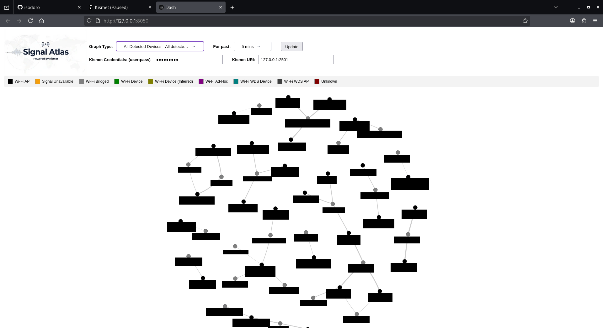 | 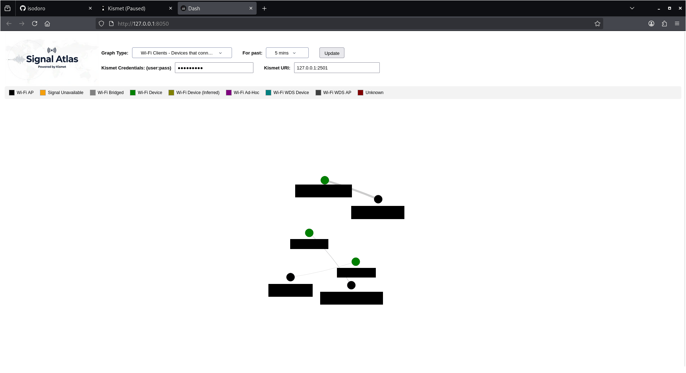 |

### Around Me

| Zoomed radar view | WPS filter applied |
|---|---|
| 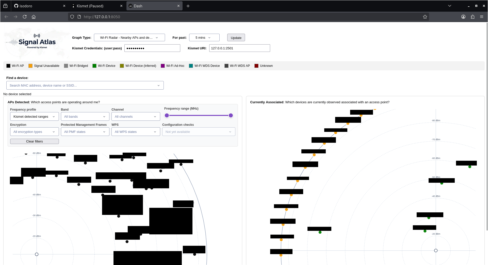 | 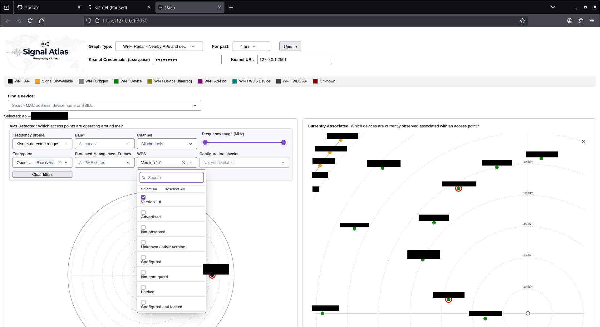 |

### Timeline

| Access point view | Client view |
|---|---|
| 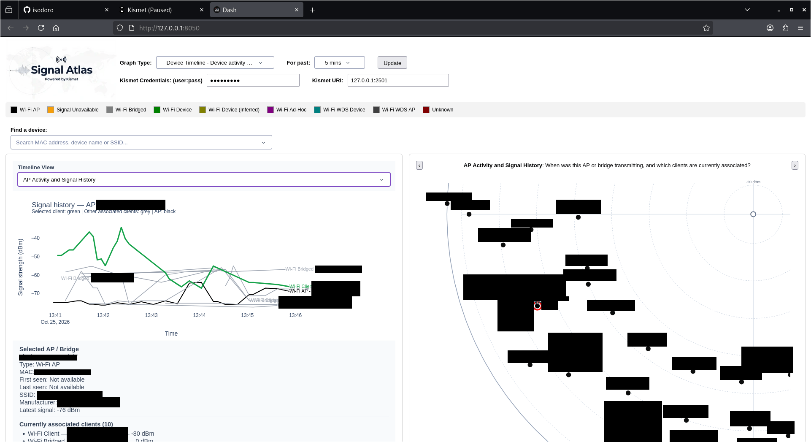 | 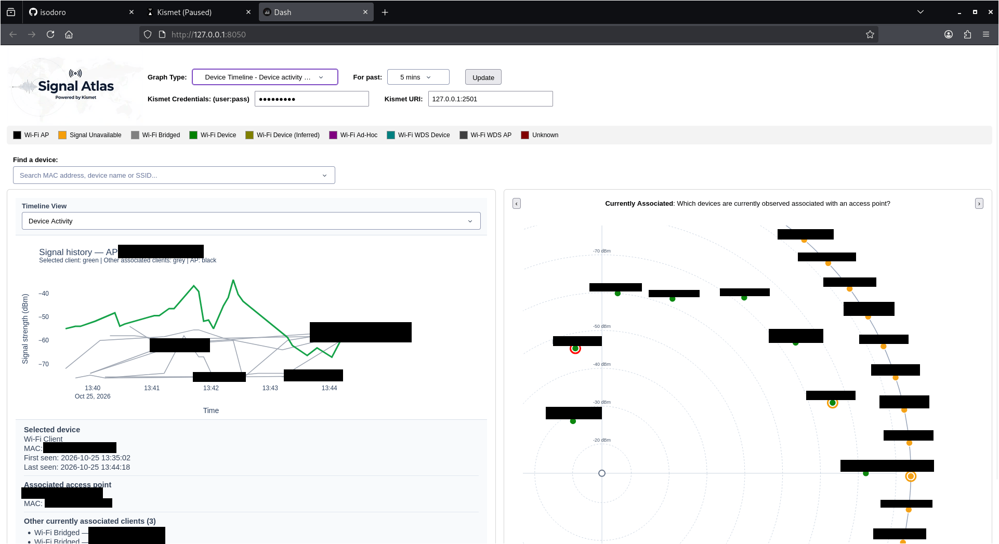 |

| Client view with associated devices | Client view with search |
|---|---|
| 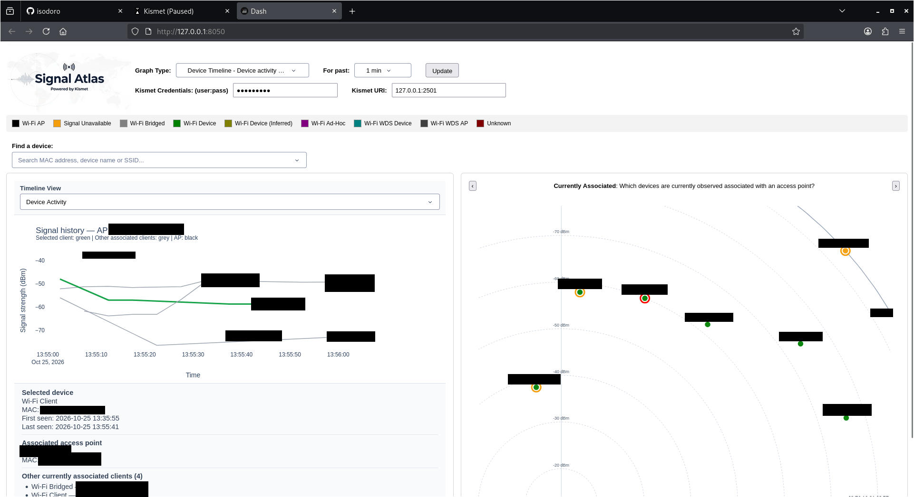 | 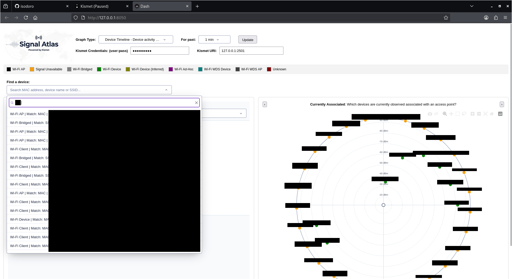 |

### Probed SSIDs

<p align="center">
  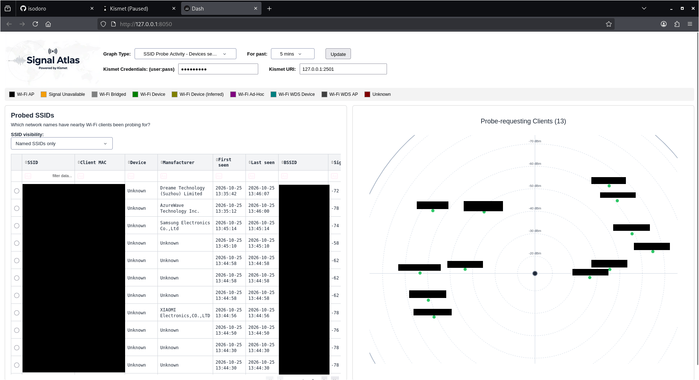
</p>

### AP Identity

<p align="center">
  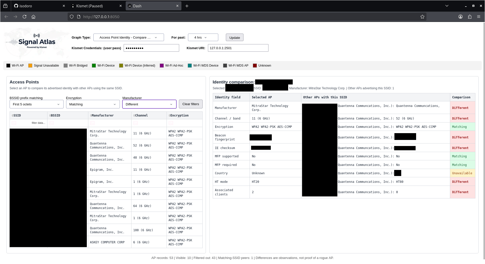
</p>

### Management Frame Anomalies

<p align="center">
  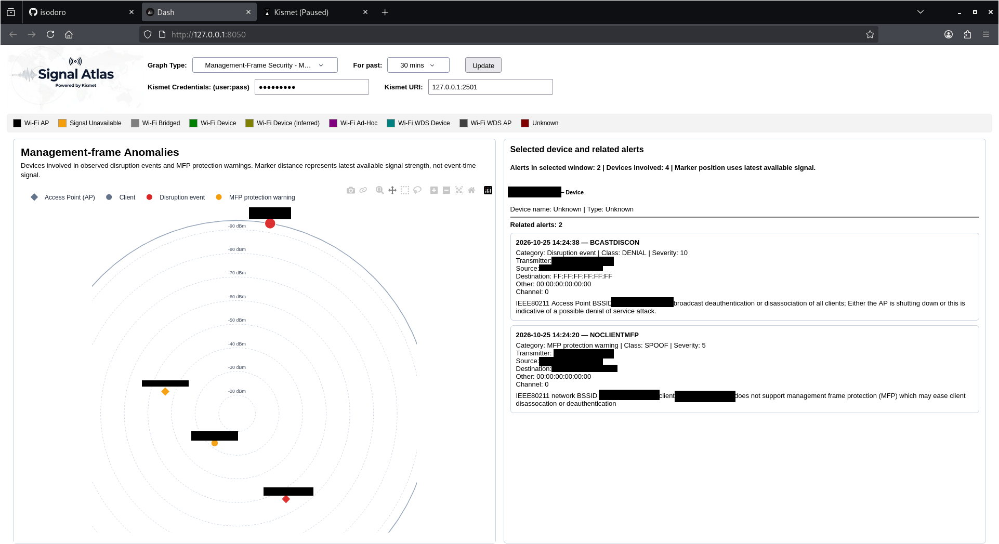
</p>

### WPA Handshakes

<p align="center">
  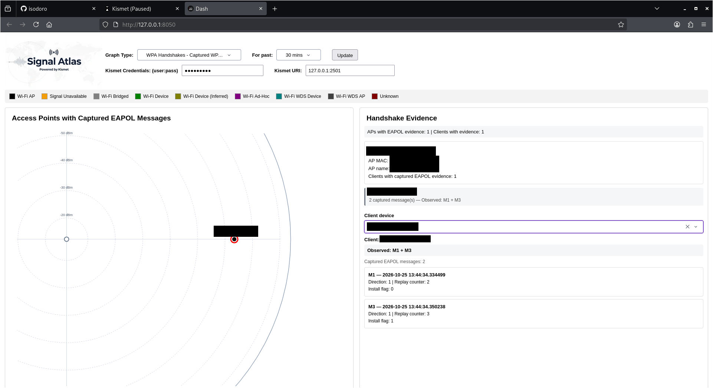
</p>

## Requirements

- Linux (64-bit).
- Python 3.13 or later for manual installation.
- Kismet installed and running on the host machine.
- A working Kismet HTTP API.

Docker installation additionally requires Docker Engine and Docker Compose.

Signal Atlas has been tested on Kali Linux 2026.1. Manual installation was tested with Python 3.14.8, and Docker installation was also tested. The optional offline dependency bundle was separately tested with Python 3.13.12 on Linux x86-64.

## Kismet configuration

Signal Atlas uses Kismet's HTTP API.

The default connection settings used by Signal Atlas are:

| Setting | Default |
|---|---|
| Kismet host (manual installation) | `127.0.0.1` |
| Kismet host (Docker installation) | `host.docker.internal` |
| Kismet HTTP API port | `2501` |
| Kismet username | `kali` |
| Kismet password | `kali` |

These are Signal Atlas connection defaults. They assume the corresponding Kismet API credentials are valid on the target installation.

No changes to Kismet's configuration are required for the standard setup described here.

Kismet must be running before Signal Atlas can retrieve live wireless data. Signal Atlas can start without Kismet, but its views will not receive live Kismet information until the API is available.

## Installation method 1: Manual Python installation

This method runs Signal Atlas directly on Linux using a Python virtual environment.

### 1. Install system requirements

```bash
sudo apt update
sudo apt install -y git python3 python3-venv python3-pip
```

### 2. Obtain the Signal Atlas source

Clone the repository:

```bash
git clone https://github.com/isodoro/Signal-Atlas.git
cd Signal-Atlas
```

The repository is private during development. Access must be granted by the repository owner.

### 3. Create a Python virtual environment

```bash
python3 -m venv venv
source venv/bin/activate
```

### 4. Install Python dependencies

With an active virtual environment:

```bash
python -m pip install --upgrade pip
python -m pip install -r requirements.txt
```

Check the installation:

```bash
python -m pip check
```

### 5. Start Kismet

Start Kismet using your normal installation and ensure its HTTP API is available.

### 6. Start Signal Atlas

From the project directory, with the virtual environment active:

```bash
python3 KismetUIPlugin.py
```

Open the dashboard in a browser:

```text
http://127.0.0.1:8050
```

To stop Signal Atlas, press `Ctrl+C` in the terminal running the application.

To leave the virtual environment:

```bash
deactivate
```

## Installation method 2: Offline Python dependencies

An optional offline dependency bundle is provided separately from the main source repository.

This is intended for systems where internet access is unavailable or restricted.

### Bundle details

| Property | Value |
|---|---|
| Archive | `SignalAtlas-offline-python313-linux-x86_64.tar.gz` |
| Platform | Linux x86-64 |
| Python | 3.13 |
| Wheel files | 51 |
| Archive size | Approximately 121 MB |

The bundle contains the Python dependency wheels and a locked requirements file. It does not contain Signal Atlas source code, Kismet, system packages or wireless drivers.

Obtain the archive separately from the Signal Atlas release downloads.

### 1. Verify the downloaded archive

The published SHA256 checksum is:

```text
a4ace62486e903cda8b76a4f4c26253946bb8e6d1f997b84521872fed010447e
```

Run:

```bash
sha256sum SignalAtlas-offline-python313-linux-x86_64.tar.gz
```

Compare the result with the published checksum before extracting the archive.

### 2. Extract the bundle

```bash
tar -xzf SignalAtlas-offline-python313-linux-x86_64.tar.gz
cd SignalAtlas-offline-python313-linux-x86_64
```

### 3. Verify the bundle contents

Verify the top-level files:

```bash
sha256sum -c SHA256SUMS
```

Verify the dependency wheels:

```bash
cd wheelhouse
sha256sum -c SHA256SUMS
cd ..
```

All checks should report `OK`.

### 4. Install the dependencies

Return to the Signal Atlas source directory and create a virtual environment:

```bash
cd ../Signal-Atlas
python3 -m venv venv
source venv/bin/activate
```

Install the dependencies without internet access. The following example assumes the extracted dependency bundle is alongside the Signal Atlas source directory:

```bash
python -m pip install \
  --no-index \
  --find-links=../SignalAtlas-offline-python313-linux-x86_64/wheelhouse \
  -r ../SignalAtlas-offline-python313-linux-x86_64/requirements-lock.txt
```

Check the installation:

```bash
python -m pip check
```

Start Kismet and Signal Atlas as described in the manual installation instructions.

## Installation method 3: Docker

Docker runs the Signal Atlas dashboard in a container. Kismet remains installed and runs directly on the Linux host.

The container does not run Kismet and does not require wireless adapters to be passed into Docker.

### 1. Install Docker

Install Docker Engine and Docker Compose using your distribution's package manager. The following commands are for Debian-based distributions such as Kali Linux and Ubuntu:

```bash
sudo apt update
sudo apt install -y docker.io docker-compose
```

Enable and start Docker:

```bash
sudo systemctl enable --now docker
```

If your user is not already authorised to run Docker commands, use `sudo` with the Docker commands below.

### 2. Obtain the Signal Atlas source

```bash
git clone https://github.com/isodoro/Signal-Atlas.git
cd Signal-Atlas
```

### 3. Configure the Kismet connection

The supplied `compose.yaml` uses the following defaults:

- Kismet host: `host.docker.internal`
- Kismet port: `2501`
- Kismet username: `kali`
- Kismet password: `kali`

These values can be overridden using a `.env` file in the project directory.

Keep `.env` private. Do not commit it to Git or include it in public backups or source archives.

### 4. Build the Docker image

From the project directory:

```bash
docker compose build
```

### 5. Start Kismet

Start Kismet on the Linux host before starting the Signal Atlas container.

### 6. Start Signal Atlas

```bash
docker compose up -d
```

The dashboard is available locally at:

```text
http://127.0.0.1:8050
```

The supplied Compose configuration publishes the dashboard on the host's loopback interface only:

```yaml
ports:
  - "127.0.0.1:8050:8050"
```

This prevents other devices on the network from accessing the dashboard through this published port.

### 7. Container management

View container status:

```bash
docker ps
```

View application logs:

```bash
docker compose logs -f
```

Stop and remove the container and its Compose network:

```bash
docker compose down
```

The built Docker image is retained, so subsequent starts do not require a rebuild unless the source or image configuration has changed.

## Configuration

Signal Atlas supports the following environment variables:

| Variable | Default |
|---|---|
| `SIGNAL_ATLAS_KISMET_HOST` | `127.0.0.1` for manual execution; `host.docker.internal` in Docker |
| `SIGNAL_ATLAS_KISMET_PORT` | `2501` |
| `SIGNAL_ATLAS_KISMET_USER` | `kali` |
| `SIGNAL_ATLAS_KISMET_PASSWORD` | `kali` |

For a manual installation, custom values can be supplied before starting the application:

```bash
export SIGNAL_ATLAS_KISMET_HOST=127.0.0.1
export SIGNAL_ATLAS_KISMET_PORT=2501
export SIGNAL_ATLAS_KISMET_USER=your_username
export SIGNAL_ATLAS_KISMET_PASSWORD=your_password
```

Then start the application:

```bash
python3 KismetUIPlugin.py
```

For Docker, set the equivalent values in the `.env` file. Docker Compose reads this file when starting the service.

For a standard Kali Linux 2026 installation, Signal Atlas uses the default Kismet credentials: username `kali` and password `kali`. No configuration file is required unless you need to use different connection settings.

Connection settings can also be adjusted through the dashboard. These changes apply immediately but are held only in memory and are lost when Signal Atlas restarts. To retain custom settings across restarts, use environment variables or the Docker `.env` file.

## Security considerations

Signal Atlas is intended for local use on a trusted system.

- The application itself listens on `0.0.0.0` inside its runtime environment.
- The supplied Docker Compose configuration publishes port `8050` on `127.0.0.1` only.
- The application does not provide HTTPS encryption.
- Do not expose the dashboard directly to untrusted networks.
- Protect Kismet API credentials and never publish `.env` files.
- Change default credentials where appropriate for your own Kismet installation.

The Docker localhost-only port binding limits access through the published dashboard port to the host system. It does not provide authentication or HTTPS.

## Dependencies

The main application uses the following Python packages:

- Dash
- Dash Bootstrap Components
- visdcc
- pandas
- Plotly
- requests

The exact dependency versions for the offline bundle are recorded in its `requirements-lock.txt` file.

## Project structure

| File or directory | Purpose |
|---|---|
| `KismetUIPlugin.py` | Main application and dashboard entry point. |
| `signal_manager.py` | Signal and data management. |
| `signal_position.py` | Signal positioning and related calculations. |
| `signal_radar.py` | Radar visualisation support. |
| `radar_style.py` | Shared radar styling. |
| `around_me.py` | Around Me view. |
| `timeline.py` | Timeline view. |
| `probed_ssids.py` | Probed SSIDs view. |
| `ap_identity.py` | Access point identity comparison. |
| `management_frame_anomalies.py` | Management frame anomaly view. |
| `wpa_handshakes.py` | WPA handshake view. |
| `assets/` | Dashboard images, stylesheets and static assets. |
| `original_tools/` | Preserved original utility scripts. |
| `requirements.txt` | Main application Python dependencies. |
| `Dockerfile` | Docker image definition. |
| `compose.yaml` | Docker Compose service configuration. |

## Attribution and licence

Signal Atlas is based on the original open-source project [KismetUIPlugin](https://github.com/JoeTester1965/KismetUIPlugin), originally published by JoeTester1965.

The original project was distributed under the MIT License. Signal Atlas retains that licence and preserves the original copyright notice.

Copyright notices for Signal Atlas contributions are included separately in the `LICENSE` file.

The MIT License permits use, modification, distribution and commercial use, subject to its terms. The original copyright notice and licence text must be retained in copies or substantial portions of the software.

See the `LICENSE` file for the complete licence.

---

**Signal Atlas**  
An extended Kismet dashboard for wireless network visibility and analysis.
